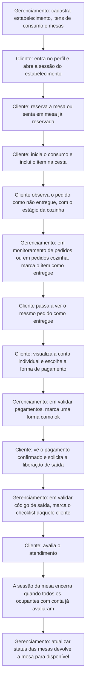

# Funcionalidades de Gerenciamento e Sessão do estabelecimento

Este documento descreve o que o 4two faz em **Gerenciamento** e em **Sessão do estabelecimento**, e o ciclo em que os dois lados se encontram: o cliente senta, pede, observa o pedido ainda não entregue, o gerenciamento altera o status, o cliente passa a ver o pedido como entregue, solicita a liberação de saída e o gerenciamento confirma essa saída.

A entrada do aplicativo é a tela **Main** (`/main`), com dois caminhos: **Gerenciamento** e **Cliente**.

## Gerenciamento

O acesso exige login em `/loginGerenciamento`. As credenciais de demonstração ficam em `src/mocks/gerenciamento.json`. A sessão autenticada abre `/gerenciamento`.

### Cadastro de estabelecimento

Inclui e edita o estabelecimento que o cliente vai escolher depois.

- Nome, tipo (Restaurante, Pizzaria ou Bar), telefone, cidade e endereço.
- A lista mostra o identificador e permite editar o registro.

### Cadastro de itens de consumo

Monta o cardápio usado na sessão da mesa.

- Vincula o item a um estabelecimento já cadastrado.
- Nome, categoria (Bebida, Drink ou Porção), preço e descrição.
- A opção **item de preparo na cozinha?** marca se o item entra no fluxo da cozinha.
- A lista permite editar e excluir.

### Cadastro de mesa

Prepara o lugar em que o cliente se senta.

- Vincula a mesa a um estabelecimento.
- Nome, tipo (externa, interna, casal ou mesaVIP) e capacidade.
- Mesa nova nasce com status **disponível** e recebe um QR code próprio.
- Na edição, status e QR code já gravados são mantidos.
- A lista mostra o QR code e permite editar e excluir.

### Monitoramento de pedidos

Painel **monitoramento de pedidos**. Agrupa o consumo por estabelecimento, mesa e cliente, com preço, data e hora, status de entrega e total.

O checkbox de cada item grava o status:

- desmarcado: **não entregue**
- marcado: **entregue**

Essa alteração é a que a sessão do cliente passa a exibir. Enquanto o checkbox não é marcado, o cliente continua vendo o pedido como **não entregue**.

### Pedidos da cozinha

O botão **pedidos cozinha** abre `/pedidosCozinha`, também protegido pelo login de gerenciamento. Os pedidos aparecem em três colunas:

1. **Não iniciado**
2. **Iniciado em preparo**
3. **Preparado aguardando entrega**

Cada linha mostra mesa, cliente, preço, data e hora, status de entrega e status da cozinha. Há três marcações independentes:

- **Iniciado em preparo**
- **Preparado aguardando entrega**
- **Entregue**

A marcação **Entregue** grava o mesmo status de entrega do monitoramento. O cliente, que até então via **não entregue** e o estágio da cozinha, passa a ver **entregue**.

### Validar pagamentos

Painel **validar pagamentos**. Lista, por mesa, o cliente, a forma escolhida e os itens já entregues. O gerenciamento escolhe um dos status de confirmação:

- pix ok
- recebido em moeda Real ok
- recebido via debito ok
- recebido via credito ok
- voucher ticket ok

Qualquer um desses status libera o pagamento daquele cliente. A mesa segue aberta para quem ainda não pagou.

### Validar código de saída

Painel **validar codigo saída cliente**. Aparece depois que o cliente gera o código de liberação. Mostra cliente, mesa, código, forma de pagamento e itens.

O checkbox **passou no checklist de saída ?** confirma a saída e registra data e hora. Só um código válido pode ser marcado. Essa confirmação é o que libera a avaliação daquele cliente.

### Atualizar status das mesas

Painel **atualizar status mesas**. Filtra por estabelecimento e relê o status de cada mesa: disponível, reservada ou indisponível.

Quando todos os ocupantes da mesa já têm pagamento confirmado, a mesa volta para **disponível**.

## Sessão do estabelecimento

O cliente entra em `/loginClientes`. As credenciais de demonstração ficam em `src/mocks/cliente.json`. Depois do login, o perfil em `/cliente` permite atualizar os dados e abrir a lista de estabelecimentos cadastrados no gerenciamento.

Ao escolher um estabelecimento, o aplicativo grava a sessão (identificador, nome, tipo, login, nome do cliente e data e hora de abertura) e abre `/sessaoestabelecimento`.

### Escolher e sentar na mesa

A tela **Quem esta com você?** só lista mesas **disponíveis** ou **reservadas** daquele estabelecimento.

1. Mesa **disponível**: o primeiro cliente reserva a mesa. O status passa a **reservada** e a ocupação começa em 1. O cliente é registrado como ocupante.
2. Mesa **reservada** com lugares livres: outro cliente informa quantas pessoas entram. A ocupação soma esses lugares. Se a soma passar da capacidade, a mesa não é aberta e a tela avisa que ela não comporta aquele número.
3. Quando a ocupação alcança a capacidade, a mesa fica **indisponível**.

Com a mesa ativa, a tela mostra a sessão, o cliente, a abertura, o estabelecimento, o QR code da mesa e o desenho dos lugares, com nome de quem está sentado e a frase **Capacidade atual**.

### Iniciar consumo

O botão **iniciar consumo** só funciona com mesa escolhida. O cardápio é o dos itens cadastrados para aquele estabelecimento.

Ao escolher um item, a sessão pergunta **O item será compartilhado?**

- **Não**: o item entra só na cesta de quem pediu, com valor cheio.
- **Sim**: o item é oferecido aos outros ocupantes da mesa. Cada um recebe um aviso para aceitar ou não compartilhar.

Depois da escolha, a sessão pede confirmação para incluir ou remover o item da cesta.

Itens novos nascem com:

- status de entrega **não entregue**
- status de cozinha **Não Iniciado**
- data e hora do pedido

A cesta do cliente e os ícones sobre a mesa mostram nome, preço, data e hora, **não entregue** e, enquanto não houver entrega, o estágio da cozinha. A sessão consulta o consumo a cada 3 segundos e atualiza cozinha, assentos e ofertas de compartilhamento sem esperar o gerenciamento.

### Compartilhar um item

Quem recebe a oferta vê a mensagem do autor, o nome, a descrição, a categoria e o preço, com as opções de aceitar ou não compartilhar.

Ao aceitar, entra da esquerda para a direita o aviso com o indicador positivo e o texto **OK, você pode compartilhar deste item assim que ele for entregue na mesa.** Depois de 3 segundos, o pedido de aceite e essa confirmação se recolhem.

Na conta, o preço do item compartilhado é dividido pelo número de ocupantes com sessão ativa que aceitaram aquele item. Quem não aceitou não leva essa parte. Item não compartilhado continua com o valor cheio de quem pediu.

### Ver a conta e pagar

Com a mesa ativa, **visualizar conta** abre a conta individual. Itens ainda não entregues aparecem com esse status. O botão **Fechar e pagar minha conta** segue para a escolha da forma:

- PIX QR dinâmico ou copia e cola
- Cartão por aproximação
- Carteira digital
- Voucher-Ticket

A tela mostra o valor da parte daquele cliente e, para PIX, o QR code e o copia e cola. A escolha gera o registro que o gerenciamento localiza em **validar pagamentos**.

Em **Validar pagamento**, o cliente espera a confirmação do gerenciamento. Enquanto nenhuma forma estiver marcada como ok, a tela informa que o pagamento pode estar sendo processado. Quando o gerenciamento escolhe um status ok, o cliente vê **Pagamento confirmado**.

### Solicitar a liberação de saída

Só com o pagamento confirmado aparece **Gerar confirmação de saída**. O cliente gera o **código de liberação** da própria conta. Cada ocupante gera o seu. A etapa final da conta só é concluída quando esse código existe.

A tela passa a consultar, a cada 3 segundos, se o gerenciamento marcou o checklist daquele código.

### Avaliação

Quando o gerenciamento marca **passou no checklist de saída ?** para aquele cliente, a sessão dele abre **avaliação 4two**. As notas são Ruim, Insatisfeito, Regular, Satisfeito e Muito satisfeito.

Os dois ocupantes avaliam de forma independente. A nota de um não encerra a avaliação do outro. O botão **Encerrar sessão** devolve o cliente ao perfil. A sessão da mesa e a sessão do estabelecimento só são encerradas quando todos os ocupantes que têm conta já passaram pelo checklist e já avaliaram.

Se o checklist de um cliente já foi confirmado e ele ainda não avaliou, qualquer retorno às telas da sessão, da conta ou do pagamento o leva de volta à avaliação.

## Fluxo do ciclo

A ordem abaixo é a ordem de uso. O cliente observa o pedido como **não entregue**. A mudança para **entregue** acontece na interação do gerenciamento. A solicitação do código de saída acontece no cliente. A verificação desse código acontece no gerenciamento.

| Ordem | Quem age | O que acontece | O que o outro lado vê |
| --- | --- | --- | --- |
| 1 | Gerenciamento | Cadastra estabelecimento, cardápio e mesas com QR code | O cliente encontra o estabelecimento e as mesas disponíveis |
| 2 | Cliente | Abre a sessão do estabelecimento e senta na mesa | A mesa fica reservada ou indisponível conforme a ocupação |
| 3 | Cliente | Inclui o consumo | O pedido nasce como **não entregue** e **Não Iniciado** |
| 4 | Cliente | Observa a cesta e os ícones da mesa | Continua vendo **não entregue** e o estágio da cozinha |
| 5 | Gerenciamento | Marca **entregue** no monitoramento ou em pedidos cozinha | O cliente, na consulta seguinte, passa a ver **entregue** |
| 6 | Cliente | Fecha a conta e escolhe uma forma de pagamento | O pagamento aparece em **validar pagamentos** |
| 7 | Gerenciamento | Escolhe um status ok para aquela forma | O cliente vê **Pagamento confirmado** |
| 8 | Cliente | Gera o código de liberação de saída | O código aparece em **validar código de saída** |
| 9 | Gerenciamento | Marca o checklist de saída daquele código | Aquele cliente é levado à avaliação |
| 10 | Cada cliente | Avalia e encerra a própria participação | A mesa só libera de fato quando todos os ocupantes com conta avaliaram |
